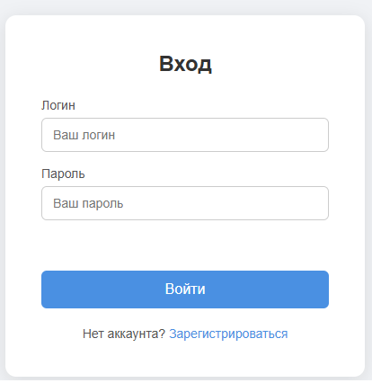

# AppSec Messenger — Flask

[Русская версия](README.ru.md)

Server-side messenger built with Python and Flask. Part of a self-paced
AppSec learning roadmap.

This is **Stage 5** of the roadmap — a Flask-based backend with **SQLite**
database integration. It builds on Stage 4 by moving user credentials and
chat messages from volatile memory into a persistent database.

## Screenshots

### Login


### Chat


## Tech Stack

- Python 3.14
- Flask 3.1
- Jinja2 (templates)
- SQLite (database)
- HTML5, CSS3, Vanilla JavaScript

## Features

- User registration with **server-side validation**
  - Username (min 3 characters)
  - Email format
  - Password (min 6 characters)
  - Password confirmation
  - Duplicate username check
- Login with credentials verification
- Session-based authentication (Flask sessions with signed cookies)
- Protected `/chat` route — accessible only to logged-in users
- Logout
- **Persistent storage** in SQLite:
  - `users` table — credentials
  - `messages` table — chat history
- **Messages API**:
  - `GET /api/messages` — fetch message history
  - `POST /api/messages` — send a new message
- Messages survive page reloads and server restarts

## Limitations (by design)

- Passwords are stored **in plaintext**.
  → Hashing — Stage 45.
- Client-side validation is **for UX only** — the server duplicates every check.
- Messages are broadcast to all users (no private conversations yet).

## Project Structure

```
appsec-messenger-flask/
├── app.py                  Flask application
├── init_db.py              Database initialization script
├── crud_test.py            CRUD practice script (optional)
├── requirements.txt        Python dependencies
├── app.db                  SQLite database (not tracked)
├── templates/
│   ├── index.html          Registration page
│   ├── login.html          Login page
│   └── chat.html           Chat page
├── static/
│   ├── css/
│   │   └── style.css       Styles
│   ├── js/
│   │   ├── auth.js         Registration form validation
│   │   └── chat.js         Chat logic
│   └── screenshots/
└── venv/                   (not tracked)
```

## Routes

| Method | URL | Description |
|--------|-----|-------------|
| GET / POST | `/` | Registration |
| GET / POST | `/login` | Login |
| GET | `/chat` | Chat (protected) |
| GET | `/logout` | Logout |
| GET / POST | `/api/messages` | Messages API (protected) |

## How to Run

1. Install **Python 3.10+**.
2. Clone the repository:
   ```bash
   git clone https://github.com/foxxxymiron/appsec-messenger-flask.git
   ```
3. Open the project folder in VS Code.
4. Create a virtual environment:
   ```bash
   python -m venv venv
   ```
5. Activate it:
   - Windows: `venv\Scripts\Activate.ps1`
   - Linux/macOS: `source venv/bin/activate`
6. Install dependencies:
   ```bash
   pip install -r requirements.txt
   ```
7. Initialize the database:
   ```bash
   python init_db.py
   ```
8. Run the server:
   ```bash
   python app.py
   ```
9. Open `http://127.0.0.1:5000` in your browser.

## Roadmap

- [x] **Stage 3** — Client-side part (HTML + CSS + JS)
- [x] **Stage 4** — Flask backend: routing, templates, simple auth
- [x] **Stage 5** — SQLite database, users and messages persistence
- [ ] Stage 6+ — Web vulnerabilities (SQLi, XSS, CSRF, etc.)

## Notes

Client-side validation is intended for UX only — it can be bypassed
via DevTools. Real validation is implemented **on the server**
(see `app.py`). This is the core principle of AppSec: **never trust the client**.

Database access uses **parameterized queries** (`?` placeholders) to prevent
SQL injection — the topic of Stage 6.

## Author

- **Ivantsov Maxim**
- GitHub: [@foxxxymiron](https://github.com/foxxxymiron)