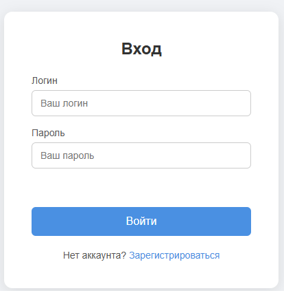
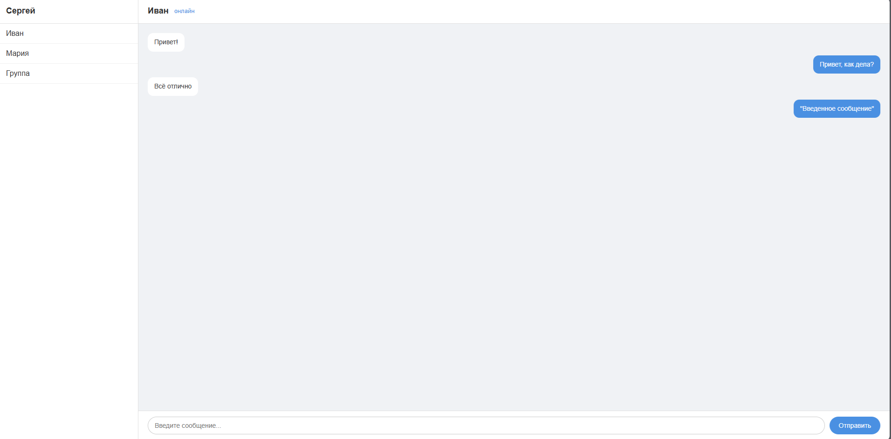

# AppSec Messenger — Flask

[Русская версия](README.ru.md)

Server-side messenger built with Python and Flask. Part of a self-paced AppSec learning roadmap.

This is the main project of the roadmap, where vulnerabilities are intentionally introduced, exploited, and then mitigated. **Stages 1-15 are completed.**

## 🎯 Roadmap Progress

- [x] **Stage 1:** Introduction to AppSec (Theory)
- [x] **Stage 2:** Python Basics (Theory & Practice)
- [x] **Stage 3:** Client-side (HTML/CSS/JS)
- [x] **Stage 4:** Flask Backend & Auth
- [x] **Stage 5:** SQLite Database & CRUD
- [x] **Stage 6:** SQL Injection (UNION-based) & Mitigation
- [x] **Stage 7:** Blind SQL Injection (Time, Boolean, Error) & Mitigation
- [x] **Stage 8:** Cross-Site Scripting (Stored XSS) & Mitigation
- [x] **Stage 9:** Cross-Site Scripting (DOM XSS) & Mitigation
- [x] **Stage 10:** Cross-Site Request Forgery (CSRF) & Mitigation
- [x] **Stage 11:** Server-Side Request Forgery (SSRF) & Mitigation
- [x] **Stage 12:** Business Logic Vulnerabilities & Mitigation
- [x] **Stage 13:** Path Traversal & Mitigation
- [x] **Stage 14:** File Inclusion (LFI) & Mitigation
- [x] **Stage 15:** Clickjacking & Mitigation

## 📝 Security Writeups
- [Stage 6: SQL Injection](writeups/stage-6-sqli.md)
- [Stage 8: Stored XSS](writeups/stage-8-xss.md)
- [Stage 9: DOM XSS](writeups/stage-9-dom-xss.md)
- [Stage 10: CSRF](writeups/stage-10-csrf.md)
- [Stage 11: SSRF](writeups/stage-11-ssrf.md)
- [Stage 12: Business Logic](writeups/stage-12-business-logic.md)
- [Stage 13: Path Traversal](writeups/stage-13-dt.md)
- [Stage 14: File Inclusion](writeups/stage-14-lfi.md)
- [Stage 15: Clickjacking](writeups/stage-15-clickjacking.md)

👉 **[View all PortSwigger labs and external writeups in the appsec-writeups repository](https://github.com/foxxxymiron/appsec-writeups)**

## Screenshots

### Login & Chat Interface



## Tech Stack

- Python 3.10+
- Flask 3.1
- Jinja2 (templates)
- SQLite (database)
- HTML5, CSS3, Vanilla JavaScript

## Features

- User registration with **server-side validation**:
  - Username (min 3 characters)
  - Email format
  - Password (min 6 characters)
  - Password confirmation
  - Duplicate username check
- Login with credentials verification
- Session-based authentication (Flask sessions with signed cookies)
- Protected `/chat` route — accessible only to logged-in users
- Logout (protected by CSRF token and POST requirement)
- **Persistent storage** in SQLite:
  - `users` table — credentials and coin balance
  - `messages` table — chat history
- **Messages API**:
  - `GET /api/messages` — fetch message history
  - `POST /api/messages` — send a new message
- **Password Change**:
  - `GET/POST /change-password` — change user password (protected by CSRF token)
- **Avatar Fetching**:
  - `GET/POST /fetch-avatar` — fetch an avatar from a URL (protected from SSRF)
- **Wallet**:
  - `GET/POST /wallet` — transfer coins between users (protected from logic flaws)
- **File Viewer**:
  - `GET /view-file` — view files from the static directory (protected from Directory Traversal)
- **Dynamic Pages**:
  - `GET /page` — render dynamic pages (protected from File Inclusion with an allowlist)
- **Security Labs (Intentionally Vulnerable):**
  - SQL Injection (UNION-based) in `/login` and `/search` (Mitigated).
  - Blind SQL Injection in `/login` (Mitigated).
  - Stored XSS in `chat.js` via `innerHTML` (Mitigated).
  - DOM XSS in `chat.html` via `innerHTML` (Mitigated).
  - CSRF in `/change-password` and `/logout` (Mitigated with CSRF tokens and POST enforcement).
  - SSRF in `/fetch-avatar` (Mitigated with URL validation).
  - Business Logic Flaw in `/wallet` (Mitigated with server-side validation).
  - Directory Traversal in `/view-file` (Mitigated with path normalization).
  - File Inclusion in `/page` (Mitigated with allowlist).
  - Clickjacking on UI actions (Mitigated with HTTP security headers).

## Limitations (by design)

- Passwords are stored **in plaintext**.
  → Hashing — Stage 45.
- Client-side validation is **for UX only** — the server duplicates every check.
- Messages are broadcast to all users (no private conversations yet).

## Project Structure

```text
appsec-messenger-flask/
├── app.py                          Flask application
├── init_db.py                      Database initialization script
├── inject_xss.py                   Script to inject XSS payload into DB (Stage 8)
├── inject_clickjacking.py          Script to inject malicious link into DB (Stage 15)
├── requirements.txt                Python dependencies
├── app.db                          SQLite database (not tracked)
├── attack/
│   └── clickjacking_realisation.html   Clickjacking exploit PoC (Stage 15)
├── templates/
│   ├── index.html                  Registration page
│   ├── login.html                  Login page
│   ├── search.html                 Search page (Vulnerable to SQLi in Stage 6)
│   ├── chat.html                   Chat page (Fixed DOM XSS in Stage 9)
│   ├── change_password.html        Password change page (Fixed CSRF in Stage 10)
│   ├── about.html                  About page (LFI test)
│   └── rules.html                  Rules page (LFI test)
├── static/
│   ├── css/
│   │   └── style.css               Styles
│   ├── js/
│   │   ├── auth.js                 Registration form validation
│   │   └── chat.js                 Chat logic (Fixed Stored XSS in Stage 8)
│   ├── img/
│   │   └── fox.png                 Background image
│   └── screenshots/
│       ├── dom-xss/                Stage 9 PoC screenshots
│       ├── csrf/                   Stage 10 PoC screenshots
│       ├── ssrf/                   Stage 11 PoC screenshots
│       ├── blv/                    Stage 12 PoC screenshots
│       ├── dt/                     Stage 13 PoC screenshots
│       ├── lfi/                    Stage 14 PoC screenshots
│       └── clickjacking/           Stage 15 PoC screenshots
├── writeups/
│   ├── stage-6-sqli.md             SQL Injection report (Stage 6)
│   ├── stage-8-xss.md              Stored XSS report (Stage 8)
│   ├── stage-9-dom-xss.md          DOM XSS report (Stage 9)
│   ├── stage-10-csrf.md            CSRF report (Stage 10)
│   ├── stage-11-ssrf.md            SSRF report (Stage 11)
│   ├── stage-12-business-logic.md  Business Logic report (Stage 12)
│   ├── stage-13-dt.md              Directory Traversal report (Stage 13)
│   ├── stage-14-lfi.md             File Inclusion report (Stage 14)
│   └── stage-15-clickjacking.md    Clickjacking report (Stage 15)
└── venv/                           (not tracked)
```

## Routes

| Method | URL | Description |
|--------|-----|-------------|
| GET / POST | `/` | Registration |
| GET / POST | `/login` | Login |
| GET | `/chat` | Chat (protected) |
| GET | `/search` | Search messages (protected, SQLi mitigated) |
| GET / POST | `/logout` | Logout (POST required with CSRF token) |
| GET / POST | `/api/messages` | Messages API (protected) |
| GET / POST | `/change-password` | Change password (protected, CSRF mitigated) |
| GET / POST | `/fetch-avatar` | Fetch avatar (protected, SSRF mitigated) |
| GET / POST | `/wallet` | Wallet (protected, logic flaw mitigated) |
| GET | `/view-file` | File viewer (protected, Directory Traversal mitigated) |
| GET | `/page` | Dynamic pages (protected, LFI mitigated) |

## How to Run

1. Install **Python 3.10+**.
2. Clone the repository:
   ```bash
   git clone https://github.com/foxxxymiron/appsec-messenger-flask.git
   ```
3. Open the project folder in VS Code.
4. Create a virtual environment:
   ```bash
   python -m venv venv
   ```
5. Activate it:
   - Windows: `venv\Scripts\Activate.ps1`
   - Linux/macOS: `source venv/bin/activate`
6. Install dependencies:
   ```bash
   pip install -r requirements.txt
   ```
7. Initialize the database:
   ```bash
   python init_db.py
   ```
8. Run the server:
   ```bash
   python app.py
   ```
9. Open `http://127.0.0.1:5000` in your browser.

## Mitigation Notes

All vulnerabilities introduced during the roadmap have been patched using best practices:
- **SQL Injection:** Prevented by using **Parameterized Queries** (`?` placeholders), which strictly separate SQL code from user input.
- **Stored XSS:** Prevented by using **Safe DOM APIs** (`textContent` instead of `innerHTML`), which treat user input as plain text and prevent HTML/JS execution.
- **DOM XSS:** Prevented by using **Safe DOM APIs** (`textContent`) for handling URL parameters on the client-side.
- **CSRF:** Prevented by implementing the **Synchronizer Token Pattern**. A unique token is generated per session, embedded in forms, and validated on the server. State-changing routes (like `/logout`) strictly require POST requests.
- **SSRF:** Prevented by implementing **strict URL validation**. Only `http/https` protocols are allowed, and requests to localhost/internal IPs are blocked.
- **Business Logic:** Prevented by implementing **strict server-side validation**. Transfer amounts are checked to be positive and within the available balance.
- **Directory Traversal:** Prevented by using **path normalization** (`os.path.realpath`) and **prefix validation** to ensure files are accessed only within the allowed directory.
- **File Inclusion:** Prevented by implementing a **strict allowlist** of permitted pages (`about`, `rules`, `chat`).
- **Clickjacking:** Prevented by implementing **HTTP Security Headers** (`X-Frame-Options: DENY` and `Content-Security-Policy: frame-ancestors 'none'`), which instruct the browser to block the application from being embedded in any iframe.

*The malicious XSS payload remains in the database to demonstrate that safe rendering prevents execution even if malicious data is stored.*

## Notes

Client-side validation is intended for UX only — it can be bypassed via DevTools. Real validation is implemented **on the server** (see `app.py`). This is the core principle of AppSec: **never trust the client**.

Security headers like `HttpOnly` cookies, safe DOM rendering, and frame-embedding restrictions provide Defense in Depth against session hijacking, XSS, and Clickjacking.

## Author

- **Ivantsov Maxim**
- GitHub: [@foxxxymiron](https://github.com/foxxxymiron)