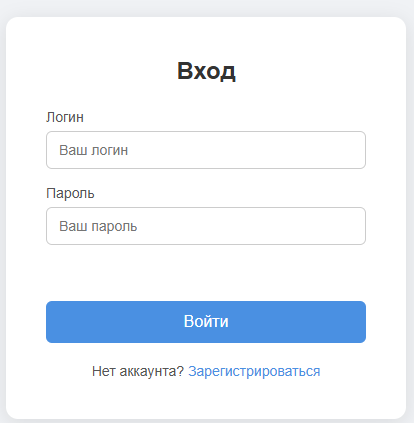
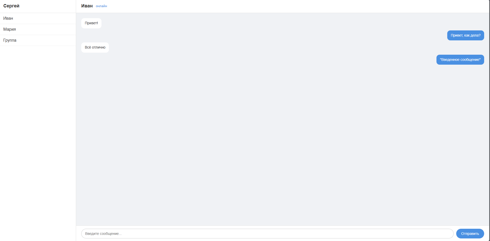

# AppSec Messenger — Flask

[English version](README.md)

Серверный мессенджер, написанный на Python и Flask. Часть самостоятельного учебного плана (roadmap) по AppSec.

Это основной проект roadmap, в котором уязвимости намеренно внедряются, эксплуатируются, а затем устраняются. **Этапы 1-15 завершены.**

## 🎯 Прогресс обучения

- [x] **Этап 1:** Введение в AppSec (Теория)
- [x] **Этап 2:** Основы Python (Теория и практика)
- [x] **Этап 3:** Клиентская часть (HTML/CSS/JS)
- [x] **Этап 4:** Flask Backend и Аутентификация
- [x] **Этап 5:** База данных SQLite и CRUD
- [x] **Этап 6:** SQL-инъекции (UNION-based) и устранение
- [x] **Этап 7:** Слепые SQL-инъекции (Time, Boolean, Error) и устранение
- [x] **Этап 8:** Межсайтовый скриптинг (Stored XSS) и устранение
- [x] **Этап 9:** Межсайтовый скриптинг (DOM XSS) и устранение
- [x] **Этап 10:** Межсайтовая подделка запроса (CSRF) и устранение
- [x] **Этап 11:** Подделка запроса на стороне сервера (SSRF) и устранение
- [x] **Этап 12:** Уязвимости бизнес-логики и устранение
- [x] **Этап 13:** Обход путей (Path Traversal) и устранение
- [x] **Этап 14:** Внедрение файлов (LFI) и устранение
- [x] **Этап 15:** Кликджекинг (Clickjacking) и устранение

## 📝 Отчеты по безопасности (Writeups)
- [Этап 6: SQL Injection](writeups/stage-6-sqli.md)
- [Этап 8: Stored XSS](writeups/stage-8-xss.md)
- [Этап 9: DOM XSS](writeups/stage-9-dom-xss.md)
- [Этап 10: CSRF](writeups/stage-10-csrf.md)
- [Этап 11: SSRF](writeups/stage-11-ssrf.md)
- [Этап 12: Business Logic](writeups/stage-12-business-logic.md)
- [Этап 13: Path Traversal](writeups/stage-13-dt.md)
- [Этап 14: File Inclusion](writeups/stage-14-lfi.md)
- [Этап 15: Clickjacking](writeups/stage-15-clickjacking.md)

👉 **[Все лабораторные работы PortSwigger и внешние отчеты смотрите в репозитории appsec-writeups](https://github.com/foxxxymiron/appsec-writeups)**

## Скриншоты

### Интерфейс входа и чата



## Технологический стек

- Python 3.10+
- Flask 3.1
- Jinja2 (шаблоны)
- SQLite (база данных)
- HTML5, CSS3, Vanilla JavaScript

## Возможности

- Регистрация пользователей с **валидацией на стороне сервера**:
  - Логин (мин. 3 символа)
  - Формат email
  - Пароль (мин. 6 символов)
  - Подтверждение пароля
  - Проверка на уникальность логина
- Вход с проверкой учетных данных
- Аутентификация на основе сессий (Flask sessions с подписанными cookie)
- Защищенный маршрут `/chat` — доступен только авторизованным пользователям
- Выход из системы (защищен CSRF-токеном и требованием POST-запроса)
- **Постоянное хранение** в SQLite:
  - Таблица `users` — учетные данные и баланс монет
  - Таблица `messages` — история чата
- **API сообщений**:
  - `GET /api/messages` — получение истории сообщений
  - `POST /api/messages` — отправка нового сообщения
- **Смена пароля**:
  - `GET/POST /change-password` — смена пароля пользователя (защищено CSRF-токеном)
- **Загрузка аватара**:
  - `GET/POST /fetch-avatar` — загрузка аватара по URL (защищено от SSRF)
- **Кошелек**:
  - `GET/POST /wallet` — перевод монет между пользователями (защищено от логических уязвимостей)
- **Просмотр файлов**:
  - `GET /view-file` — просмотр файлов из директории static (защищено от Directory Traversal)
- **Динамические страницы**:
  - `GET /page` — рендеринг динамических страниц (защищено от LFI с помощью белого списка)
- **Лабораторные работы по безопасности (намеренно уязвимые):**
  - SQL-инъекции (UNION-based) в `/login` и `/search` (Устранено).
  - Слепые SQL-инъекции в `/login` (Устранено).
  - Stored XSS в `chat.js` через `innerHTML` (Устранено).
  - DOM XSS в `chat.html` через `innerHTML` (Устранено).
  - CSRF в `/change-password` и `/logout` (Устранено с помощью CSRF-токенов и требования POST).
  - SSRF в `/fetch-avatar` (Устранено валидацией URL).
  - Уязвимость бизнес-логики в `/wallet` (Устранено строгой валидацией на сервере).
  - Directory Traversal в `/view-file` (Устранено нормализацией путей).
  - File Inclusion в `/page` (Устранено белым списком).
  - Clickjacking для действий в интерфейсе (Устранено заголовками безопасности HTTP).

## Ограничения (по замыслу)

- Пароли хранятся **в открытом виде**.
  → Хэширование — Этап 45.
- Валидация на стороне клиента предназначена **только для UX** — сервер дублирует каждую проверку.
- Сообщения транслируются всем пользователям (приватных чатов пока нет).

## Структура проекта

```text
appsec-messenger-flask/
├── app.py                          Приложение Flask
├── init_db.py                      Скрипт инициализации базы данных
├── inject_xss.py                   Скрипт внедрения XSS-нагрузки в БД (Этап 8)
├── inject_clickjacking.py          Скрипт внедрения вредоносной ссылки в БД (Этап 15)
├── requirements.txt                Зависимости Python
├── app.db                          База данных SQLite (не отслеживается)
├── attack/
│   └── clickjacking_realisation.html   PoC эксплуатации Clickjacking (Этап 15)
├── templates/
│   ├── index.html                  Страница регистрации
│   ├── login.html                  Страница входа
│   ├── search.html                 Страница поиска (Уязвима к SQLi на Этапе 6)
│   ├── chat.html                   Страница чата (Исправлен DOM XSS на Этапе 9)
│   ├── change_password.html        Страница смены пароля (Исправлен CSRF на Этапе 10)
│   ├── about.html                  Страница "О нас" (Тест LFI)
│   └── rules.html                  Страница "Правила" (Тест LFI)
├── static/
│   ├── css/
│   │   └── style.css               Стили
│   ├── js/
│   │   ├── auth.js                 Валидация формы регистрации
│   │   └── chat.js                 Логика чата (Исправлен Stored XSS на Этапе 8)
│   ├── img/
│   │   └── fox.png                 Фоновое изображение
│   └── screenshots/
│       ├── dom-xss/                Скриншоты PoC Этапа 9
│       ├── csrf/                   Скриншоты PoC Этапа 10
│       ├── ssrf/                   Скриншоты PoC Этапа 11
│       ├── blv/                    Скриншоты PoC Этапа 12
│       ├── dt/                     Скриншоты PoC Этапа 13
│       ├── lfi/                    Скриншоты PoC Этапа 14
│       └── clickjacking/           Скриншоты PoC Этапа 15
├── writeups/
│   ├── stage-6-sqli.md             Отчет по SQL Injection (Этап 6)
│   ├── stage-8-xss.md              Отчет по Stored XSS (Этап 8)
│   ├── stage-9-dom-xss.md          Отчет по DOM XSS (Этап 9)
│   ├── stage-10-csrf.md            Отчет по CSRF (Этап 10)
│   ├── stage-11-ssrf.md            Отчет по SSRF (Этап 11)
│   ├── stage-12-business-logic.md  Отчет по Business Logic (Этап 12)
│   ├── stage-13-dt.md              Отчет по Directory Traversal (Этап 13)
│   ├── stage-14-lfi.md             Отчет по File Inclusion (Этап 14)
│   └── stage-15-clickjacking.md    Отчет по Clickjacking (Этап 15)
└── venv/                           (не отслеживается)
```

## Маршруты (Routes)

| Метод | URL | Описание |
|--------|-----|-------------|
| GET / POST | `/` | Регистрация |
| GET / POST | `/login` | Вход в систему |
| GET | `/chat` | Чат (защищен) |
| GET | `/search` | Поиск сообщений (защищен, SQLi устранен) |
| GET / POST | `/logout` | Выход из системы (требуется POST с CSRF-токеном) |
| GET / POST | `/api/messages` | API сообщений (защищен) |
| GET / POST | `/change-password` | Смена пароля (защищен, CSRF устранен) |
| GET / POST | `/fetch-avatar` | Загрузка аватара (защищен, SSRF устранен) |
| GET / POST | `/wallet` | Кошелек (защищен, логическая уязвимость устранена) |
| GET | `/view-file` | Просмотр файлов (защищен, Directory Traversal устранен) |
| GET | `/page` | Динамические страницы (защищен, LFI устранен) |

## Как запустить

1. Установите **Python 3.10+**.
2. Клонируйте репозиторий:
   ```bash
   git clone https://github.com/foxxxymiron/appsec-messenger-flask.git
   ```
3. Откройте папку проекта в VS Code.
4. Создайте виртуальное окружение:
   ```bash
   python -m venv venv
   ```
5. Активируйте его:
   - Windows: `venv\Scripts\Activate.ps1`
   - Linux/macOS: `source venv/bin/activate`
6. Установите зависимости:
   ```bash
   pip install -r requirements.txt
   ```
7. Инициализируйте базу данных:
   ```bash
   python init_db.py
   ```
8. Запустите сервер:
   ```bash
   python app.py
   ```
9. Откройте `http://127.0.0.1:5000` в вашем браузере.

## Примечания по устранению уязвимостей

Все уязвимости, внедренные в ходе обучения, были исправлены с использованием лучших практик:
- **SQL Injection:** Предотвращено с помощью **параметризованных запросов** (заполнители `?`), которые строго разделяют SQL-код и пользовательский ввод.
- **Stored XSS:** Предотвращено с помощью **безопасных DOM API** (`textContent` вместо `innerHTML`), которые обрабатывают пользовательский ввод как обычный текст и предотвращают выполнение HTML/JS.
- **DOM XSS:** Предотвращено с помощью **безопасных DOM API** (`textContent`) для обработки параметров URL на стороне клиента.
- **CSRF:** Предотвращено внедрением **паттерна синхронизатора токенов**. Уникальный токен генерируется для каждой сессии, встраивается в формы и проверяется на сервере. Маршруты, изменяющие состояние (например, `/logout`), строго требуют POST-запросов.
- **SSRF:** Предотвращено внедрением **строгой валидации URL**. Разрешены только протоколы `http/https`, а запросы к localhost/внутренним IP-адресам заблокированы.
- **Business Logic:** Предотвращено внедрением **строгой валидации на стороне сервера**. Суммы переводов проверяются на положительное значение и наличие достаточного баланса.
- **Directory Traversal:** Предотвращено с помощью **нормализации путей** (`os.path.realpath`) и **проверки префикса**, чтобы гарантировать доступ к файлам только внутри разрешенной директории.
- **File Inclusion:** Предотвращено внедрением **строгого белого списка** разрешенных страниц (`about`, `rules`, `chat`).
- **Clickjacking:** Предотвращено внедрением **заголовков безопасности HTTP** (`X-Frame-Options: DENY` и `Content-Security-Policy: frame-ancestors 'none'`), которые предписывают браузеру блокировать встраивание приложения в любые iframe.

*Вредоносная XSS-нагрузка остается в базе данных, чтобы продемонстрировать, что безопасный рендеринг предотвращает выполнение кода, даже если вредоносные данные сохранены.*

## Дополнительные заметки

Валидация на стороне клиента предназначена только для улучшения UX — её можно обойти через DevTools. Реальная валидация реализована **на стороне сервера** (см. `app.py`). Это основной принцип AppSec: **никогда не доверяй клиенту**.

Заголовки безопасности (например, `HttpOnly` для cookie), безопасный рендеринг DOM и ограничения на встраивание фреймов обеспечивают защиту в глубину (Defense in Depth) от перехвата сессий, XSS и кликджекинга.

## Автор

- **Иванцов Максим**
- GitHub: [@foxxxymiron](https://github.com/foxxxymiron)