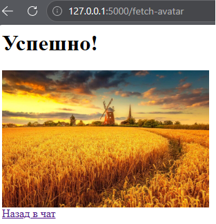
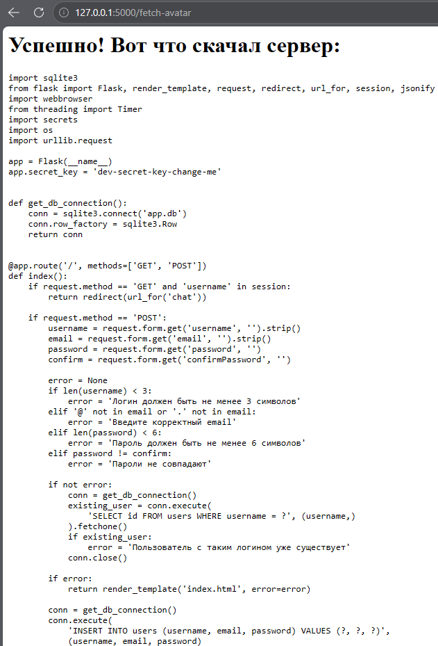
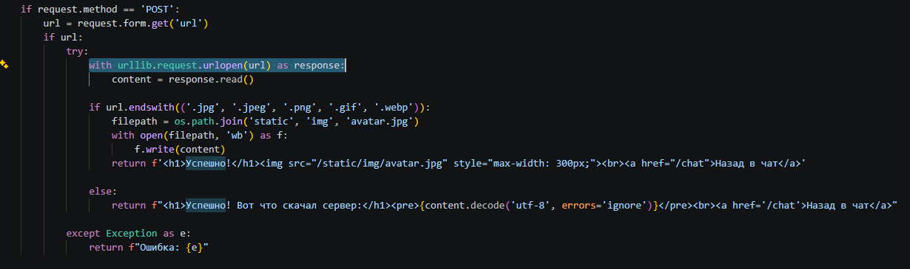
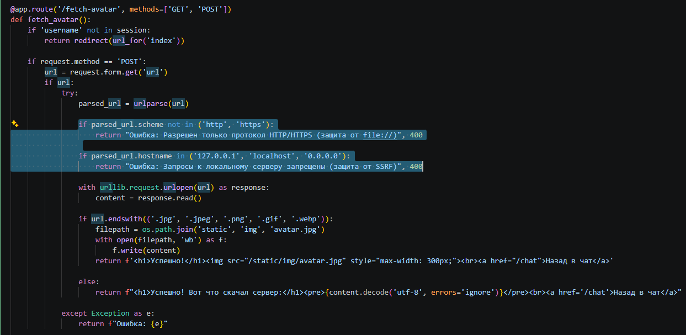
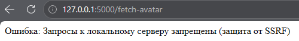

# Server-Side Request Forgery (Stage 11)

## Vulnerability Description
The application was found vulnerable to Server-Side Request Forgery (SSRF) and Local File Inclusion (LFI) in the avatar fetching functionality (`/fetch-avatar`). 

The root cause is the lack of validation on the user-supplied URL. The server uses the `urllib.request.urlopen()` function to fetch data based on the provided URL. Because there are no restrictions on the protocol or the destination host, an attacker can force the server to make requests to internal resources, including the local filesystem.

## Exploitation Steps
1. Logged in to the application and navigated to the avatar upload feature (`/fetch-avatar`).
2. Tested the standard functionality by uploading a legitimate image from the internet to confirm the feature works as intended.
3. Exploited the vulnerability by submitting a payload using the `file://` protocol to read local files on the server:
   ```text
   file:///C:/path/to/appsec-messenger-flask/app.py
   ```
   *(Note: The exact path depends on the server's file system. The attacker can easily guess or discover it).*
4. The server executed the request and returned the contents of the `app.py` file directly to the browser. This exposed sensitive information, including the Flask `app.secret_key`.
5. Additionally, forced the server to make an internal HTTP request to `http://127.0.0.1:5000/chat`, which is normally inaccessible from the outside.

## Evidence

### Normal Functionality


### Exploit Request (Reading Local File)


### Vulnerable Code


## Mitigation
To fix the vulnerability, strict validation of user-supplied URLs was implemented in the backend.

1. **Protocol Restriction:** The application parses the URL and allows only `http://` and `https://` schemes. Dangerous protocols like `file://`, `gopher://`, and `dict://` are blocked.
2. **IP/Host Blocking:** The application checks the hostname of the URL and explicitly denies requests to localhost (`127.0.0.1`, `localhost`, `0.0.0.0`) and internal network addresses.

These checks prevent the server from being used as a proxy to access local files or internal services.

## Evidence (Defense)

### Fixed Code


### Exploit Failed (Blocked Request)
