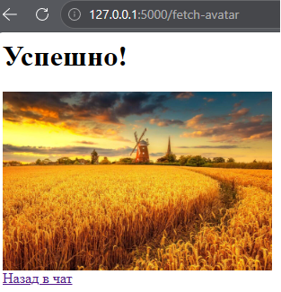
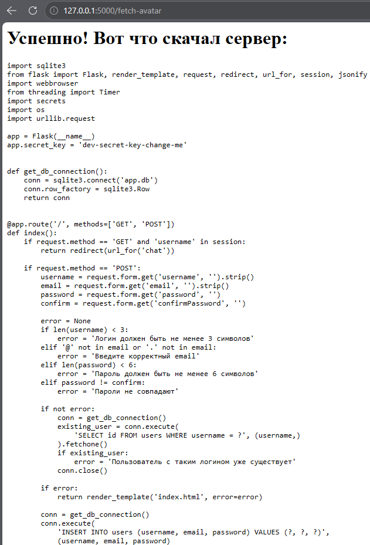
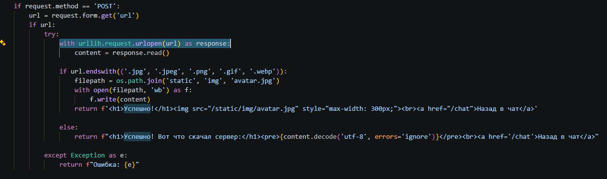
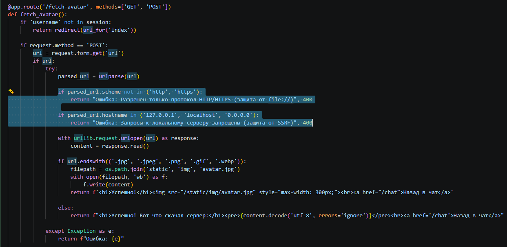
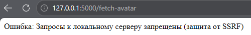

# Server-Side Request Forgery (Этап 11)

## Описание уязвимости
В приложении была обнаружена уязвимость Server-Side Request Forgery (SSRF) и Local File Inclusion (LFI) в функционале загрузки аватара (`/fetch-avatar`). 

Корневой причиной является отсутствие проверки пользовательского URL. Сервер использует функцию `urllib.request.urlopen()` для получения данных по указанному URL. Поскольку отсутствуют ограничения на протокол или хост назначения, злоумышленник может заставить сервер делать запросы к внутренним ресурсам, включая локальную файловую систему.

## Шаги эксплуатации
1. Выполнен вход в приложение и осуществлен переход в функционал загрузки аватара (`/fetch-avatar`).
2. Проверена штатная работоспособность функции путем загрузки обычной картинки из интернета.
3. Уязвимость проэксплуатирована отправкой пейлоада с использованием протокола `file://` для чтения локальных файлов на сервере:
   ```text
   file:///C:/путь/до/appsec-messenger-flask/app.py
   ```
   *(Примечание: Точный путь зависит от файловой системы сервера. Злоумышленник может легко его угадать или узнать).*
4. Сервер выполнил запрос и вернул содержимое файла `app.py` прямо в браузер. Это раскрыло конфиденциальную информацию, включая `app.secret_key` Flask.
5. Дополнительно сервер был вынужден сделать внутренний HTTP-запрос к `http://127.0.0.1:5000/chat`, который обычно недоступен извне.

## Доказательства

### Штатная работа функции


### Эксплуатация (Чтение локального файла)


### Уязвимый код


## Меры защиты (Mitigation)
Для устранения уязвимости на бэкенде была внедрена строгая валидация пользовательских URL.

1. **Ограничение протоколов:** Приложение парсит URL и разрешает только схемы `http://` и `https://`. Опасные протоколы, такие как `file://`, `gopher://` и `dict://`, блокируются.
2. **Блокировка IP/Хостов:** Приложение проверяет имя хоста в URL и явно запрещает запросы к localhost (`127.0.0.1`, `localhost`, `0.0.0.0`) и внутренним сетевым адресам.

Эти проверки предотвращают использование сервера в качестве прокси для доступа к локальным файлам или внутренним сервисам.

## Доказательства (Защита)

### Исправленный код


### Провал атаки (Заблокированный запрос)
