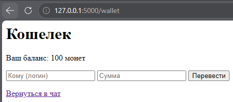
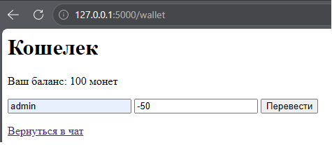
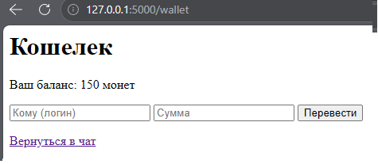
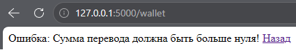

# Business Logic Vulnerability (Stage 12)

## Vulnerability Description
The application contains a wallet functionality (`/wallet`) that allows users to transfer coins to each other. The server processed the transfer amount without validating that it is a positive number. 

Because the application subtracted the transfer amount from the sender's balance and added it to the recipient's balance, an attacker could send a negative amount (e.g., `-50`). This resulted in the sender's balance increasing (subtracting a negative number) and the recipient's balance decreasing.

## Test Scenarios
1. Transfer a negative amount (e.g., `-50`).
2. Transfer more coins than the current balance (e.g., `150` with a balance of `100`).
3. Transfer coins to a non-existent user.
4. Transfer coins to yourself.

## Exploitation Steps
1. Logged in as user `admin` (initial balance: 100 coins).
2. Navigated to the `/wallet` page.
3. Entered the recipient's username and a negative amount (`-50`) in the transfer form.
4. Submitted the form. The server executed the transfer without validation.
5. Refreshed the wallet page. The balance increased to 150 coins instead of decreasing.

## Evidence

### Wallet Before Transfer

### Transfer Form (Negative Amount)

### Wallet After Transfer (Balance Increased)

## Mitigation
To fix this vulnerability, strict server-side validation was implemented in the `/wallet` route.
1. **Positive Amount Validation:** The server checks that the transfer amount is strictly greater than zero (`amount <= 0`). If not, the request is rejected.
2. **Sufficient Balance Validation:** The server checks that the sender has enough coins to complete the transfer.
3. **State Consistency:** The transfer is only executed if both checks pass.

## Evidence (Defense)

### Fixed Code (Error Message)
