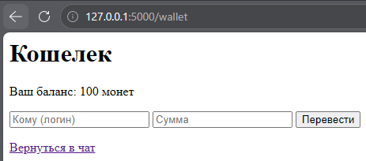
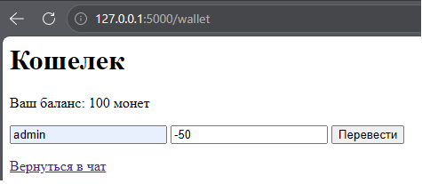
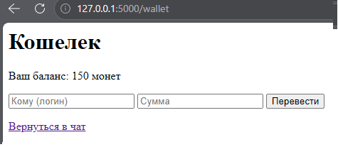
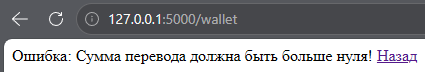

# Business Logic Vulnerability (Этап 12)

## Описание уязвимости
Приложение содержит функционал кошелька (`/wallet`), который позволяет пользователям переводить монеты друг другу. Сервер обрабатывал сумму перевода без проверки на то, что она является положительным числом.

Поскольку приложение вычитало сумму перевода из баланса отправителя и прибавляло её к балансу получателя, злоумышленник мог отправить отрицательную сумму (например, `-50`). Это приводило к увеличению баланса отправителя (вычитание отрицательного числа) и уменьшению баланса получателя.

## Тестовые сценарии
1. Перевод отрицательной суммы (например, `-50`).
2. Перевод суммы, превышающей текущий баланс (например, `150` при балансе `100`).
3. Перевод монет несуществующему пользователю.
4. Перевод монет самому себе.

## Шаги эксплуатации
1. Выполнен вход под пользователем `admin` (начальный баланс: 100 монет).
2. Выполнен переход на страницу `/wallet`.
3. В форме перевода введен логин получателя и отрицательная сумма (`-50`).
4. Форма отправлена. Сервер выполнил перевод без валидации.
5. Страница кошелька обновлена. Баланс увеличился до 150 монет вместо того, чтобы уменьшиться.

## Доказательства

### Кошелек до перевода

### Форма перевода (Отрицательная сумма)

### Кошелек после перевода (Баланс увеличился)

## Меры защиты (Mitigation)
Для устранения уязвимости в маршруте `/wallet` была внедрена строгая серверная валидация.
1. **Проверка положительной суммы:** Сервер проверяет, что сумма перевода строго больше нуля (`amount <= 0`). Если это не так, запрос отклоняется.
2. **Проверка достаточности баланса:** Сервер проверяет, что у отправителя достаточно монет для совершения перевода.
3. **Согласованность состояния:** Перевод выполняется только в том случае, если обе проверки пройдены.

## Доказательства (Защита)

### Исправленный код (Сообщение об ошибке)
