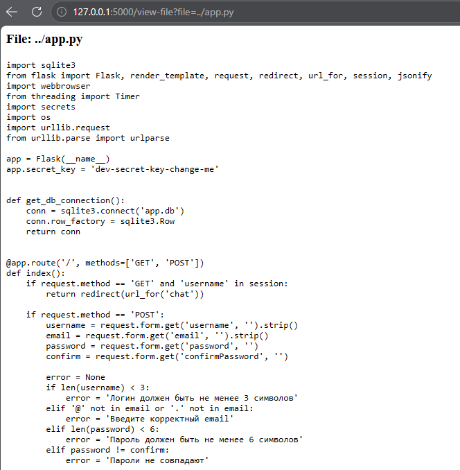
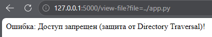

# Directory Traversal (Stage 13)

## Vulnerability Description
The application contains a file viewer functionality (`/view-file`) that allows users to read files from the `static` directory. 

The vulnerable code used `os.path.join('static', filename)` without validating the final path. By passing a payload like `../app.py`, the server traversed out of the `static` directory and exposed the application's source code. This allowed an attacker to read sensitive files, including `app.py` and `app.db`.

## Test Scenarios
1. Read a legitimate file: `?file=img/fox.png`.
2. Traverse up one directory to read source code: `?file=../app.py`.
3. Traverse up to read the database: `?file=../app.db`.

## Exploitation Steps
1. Logged in to the messenger.
2. Navigated to the "Files" page (`/view-file?file=img/fox.png`). The image was displayed successfully.
3. Modified the `file` parameter in the URL to `../app.py`.
4. The server concatenated the path and returned the source code of `app.py`, exposing the `app.secret_key` and database structure.

## Evidence

### Normal File Viewing


### Directory Traversal Exploit (Reading app.py)


## Mitigation
To fix this vulnerability, strict path normalization and prefix validation were implemented in the `/view-file` route.

1. **Normalization:** The server uses `os.path.realpath()` to resolve the absolute, canonical path, collapsing any `../` sequences.
2. **Prefix Validation:** The server checks that the resolved path starts with the allowed base directory (`static`). If it does not, access is denied.

### Vulnerable Code (Before)
```python
filepath = os.path.join('static', filename)
with open(filepath, 'r') as f:
    content = f.read()
```

### Fixed Code (After)
```python
base_dir = os.path.realpath('static')
filepath = os.path.realpath(os.path.join(base_dir, filename))
if not filepath.startswith(base_dir):
    return "Access denied", 403
```

## Evidence (Defense)

### Exploit Failed (Access Denied)
