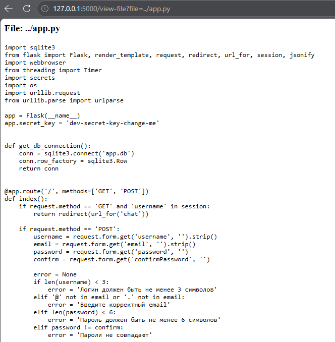
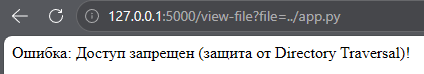

# Directory Traversal (Этап 13)

## Описание уязвимости
Приложение содержит функционал просмотра файлов (`/view-file`), который позволяет пользователям читать файлы из директории `static`.

Уязвимый код использовал `os.path.join('static', filename)` без проверки итогового пути. Передав пейлоад вроде `../app.py`, злоумышленник мог выйти за пределы директории `static` и получить доступ к исходному коду приложения. Это позволяло читать конфиденциальные файлы, включая `app.py` и `app.db`.

## Тестовые сценарии
1. Чтение легитимного файла: `?file=img/fox.png`.
2. Выход на уровень выше для чтения исходного кода: `?file=../app.py`.
3. Выход на уровень выше для чтения базы данных: `?file=../app.db`.

## Шаги эксплуатации
1. Выполнен вход в мессенджер.
2. Выполнен переход на страницу "Файлы" (`/view-file?file=img/fox.png`). Изображение успешно отобразилось.
3. Параметр `file` в URL изменен на `../app.py`.
4. Сервер объединил пути и вернул исходный код `app.py`, раскрыв `app.secret_key` и структуру базы данных.

## Доказательства

### Штатный просмотр файла


### Эксплуатация Directory Traversal (Чтение app.py)


## Меры защиты (Mitigation)
Для устранения уязвимости в маршруте `/view-file` была внедрена строгая нормализация путей и проверка префикса.
1. **Нормализация:** Сервер использует `os.path.realpath()` для получения абсолютного, канонического пути, что «схлопывает» любые последовательности `../`.
2. **Проверка префикса:** Сервер проверяет, что итоговый путь начинается с разрешенной базовой директории (`static`). Если это не так, доступ запрещается.

### Уязвимый код (До)
```python
filepath = os.path.join('static', filename)
with open(filepath, 'r') as f:
    content = f.read()
```

### Исправленный код (После)
```python
base_dir = os.path.realpath('static')
filepath = os.path.realpath(os.path.join(base_dir, filename))
if not filepath.startswith(base_dir):
    return "Доступ запрещен", 403
```

## Доказательства (Защита)

### Провал атаки (Доступ запрещен)
