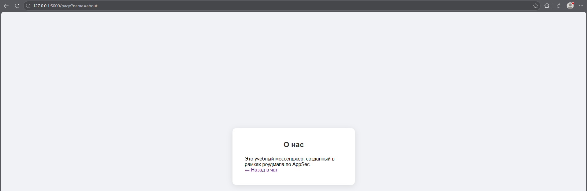
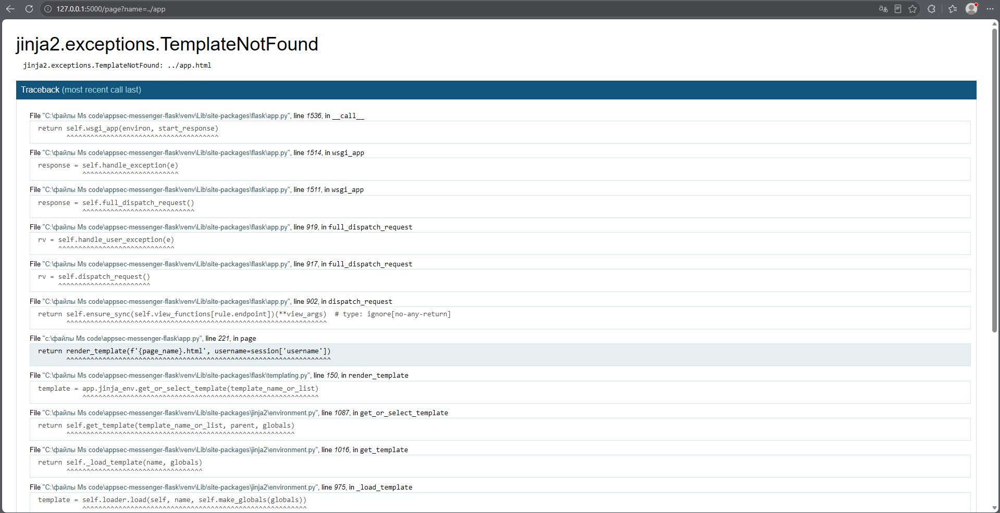
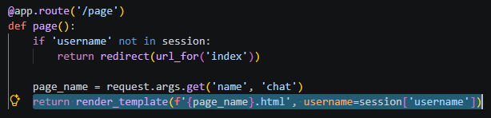
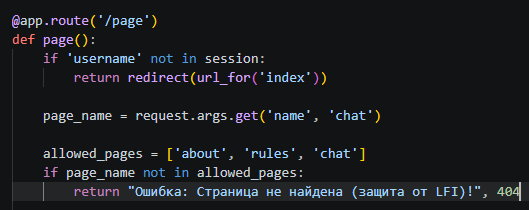

# File Inclusion (Stage 14)

## Vulnerability Description
The application contains a dynamic page rendering functionality (`/page`) that allows users to load pages by specifying their name in the `name` parameter. 

The vulnerable code passed the user-supplied page name directly into the `render_template()` function without any validation. This allowed an attacker to attempt path traversal (e.g., `../app`) to load templates outside the designated `templates` directory.

While Flask's Jinja2 template engine blocked the actual file inclusion (by throwing a `TemplateNotFound` error), the application still exposed sensitive information (absolute file paths, library versions, and code structure) through the debug error traceback.

## Test Scenarios
1. Load a legitimate page: `?name=about`.
2. Attempt to load a non-existent page outside the templates directory: `?name=../app`.

## Exploitation Steps
1. Logged in to the messenger.
2. Navigated to the "About" page using the menu (`/page?name=about`). The page loaded successfully.
3. Modified the `name` parameter in the URL to `../app` to attempt path traversal.
4. The server attempted to render `../app.html`, which resulted in a `jinja2.exceptions.TemplateNotFound` error.
5. The error traceback revealed the full server path (`C:\...\appsec-messenger-flask\`), the vulnerable line of code (`return render_template(...)`), and the versions of the libraries used.

## Evidence

### Normal Page Rendering


### Error Traceback (Information Leak)


### Vulnerable Code


## Mitigation
To fix this vulnerability, a strict allowlist of permitted pages was implemented in the `/page` route.

1. **Allowlist Validation:** The server checks if the requested `page_name` is in a predefined list of allowed pages (`about`, `rules`, `chat`). If it is not, the request is rejected with a 404 error.
2. **Secure Rendering:** The template is only rendered if the page name passes the allowlist check.

### Fixed Code
```python
@app.route('/page')
def page():
    if 'username' not in session:
        return redirect(url_for('index'))
    
    page_name = request.args.get('name', 'chat')
    allowed_pages = ['about', 'rules', 'chat']
    
    if page_name not in allowed_pages:
        return "Ошибка: Страница не найдена (защита от LFI)!", 404
        
    return render_template(f'{page_name}.html', username=session['username'])
```

## Evidence (Defense)

### Exploit Failed (Access Denied)
