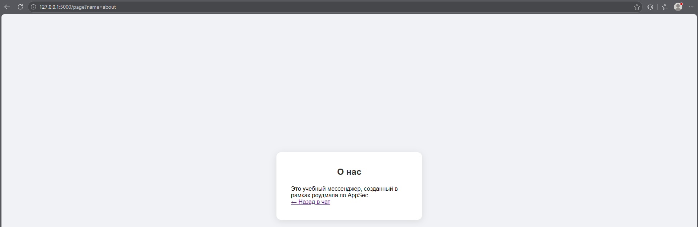
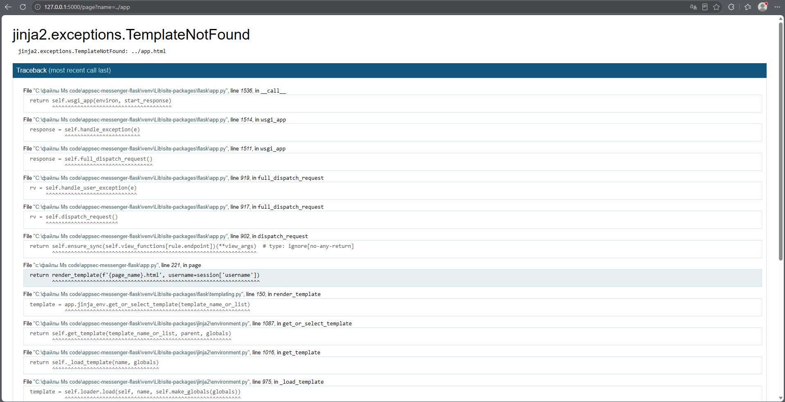
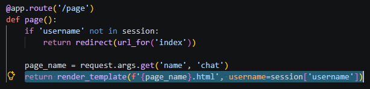
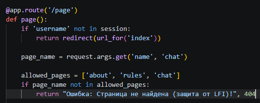

# File Inclusion (Этап 14)

## Описание уязвимости
Приложение содержит функционал динамического отображения страниц (`/page`), который позволяет загружать страницы, указывая их имя в параметре `name`.

Уязвимый код передавал имя страницы, введенное пользователем, напрямую в функцию `render_template()` без какой-либо проверки. Это позволяло злоумышленнику попытаться выйти за пределы папки `templates` с помощью обхода путей (например, `../app`).

Хотя шаблонизатор Flask (Jinja2) заблокировал фактическое включение файла (выдав ошибку `TemplateNotFound`), приложение все равно раскрыло конфиденциальную информацию (абсолютные пути к файлам, версии библиотек и структуру кода) через отладочный стек вызовов (traceback).

## Тестовые сценарии
1. Загрузка легитимной страницы: `?name=about`.
2. Попытка загрузить несуществующую страницу вне папки templates: `?name=../app`.

## Шаги эксплуатации
1. Выполнен вход в мессенджер.
2. Выполнен переход на страницу "О нас" через меню (`/page?name=about`). Страница успешно загрузилась.
3. Параметр `name` в URL изменен на `../app` для попытки обхода пути.
4. Сервер попытался отрендерить `../app.html`, что привело к ошибке `jinja2.exceptions.TemplateNotFound`.
5. Стек вызовов ошибки раскрыл полный путь к серверу (`C:\...\appsec-messenger-flask\`), уязвимую строку кода (`return render_template(...)`) и версии используемых библиотек.

## Доказательства

### Штатное отображение страницы


### Стек вызовов ошибки (Утечка информации)


### Уязвимый код


## Меры защиты (Mitigation)
Для устранения уязвимости в маршруте `/page` был внедрен строгий белый список разрешенных страниц.

1. **Проверка по белому списку:** Сервер проверяет, что запрошенный `page_name` входит в заранее заданный список разрешенных страниц (`about`, `rules`, `chat`). Если это не так, запрос отклоняется с ошибкой 404.
2. **Безопасный рендеринг:** Шаблон отображается только в том случае, если имя страницы прошло проверку по белому списку.

### Исправленный код
```python
@app.route('/page')
def page():
    if 'username' not in session:
        return redirect(url_for('index'))
    
    page_name = request.args.get('name', 'chat')
    allowed_pages = ['about', 'rules', 'chat']
    
    if page_name not in allowed_pages:
        return "Ошибка: Страница не найдена (защита от LFI)!", 404
        
    return render_template(f'{page_name}.html', username=session['username'])
```

## Доказательства (Защита)

### Провал атаки (Доступ запрещен)
