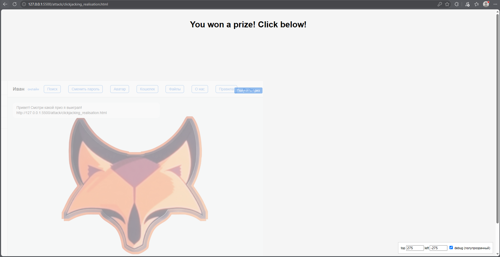
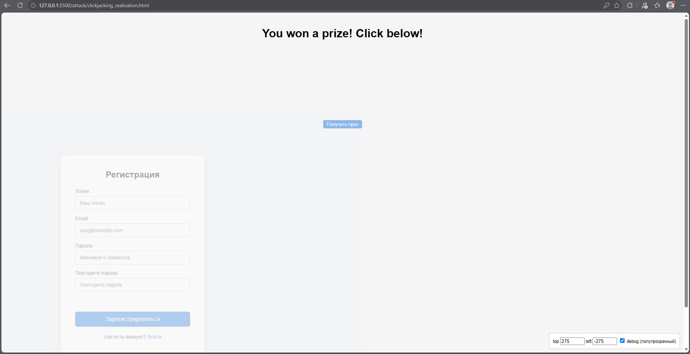
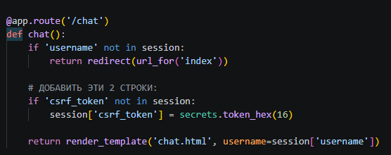
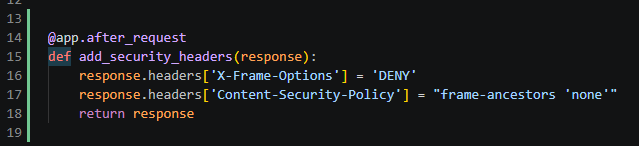
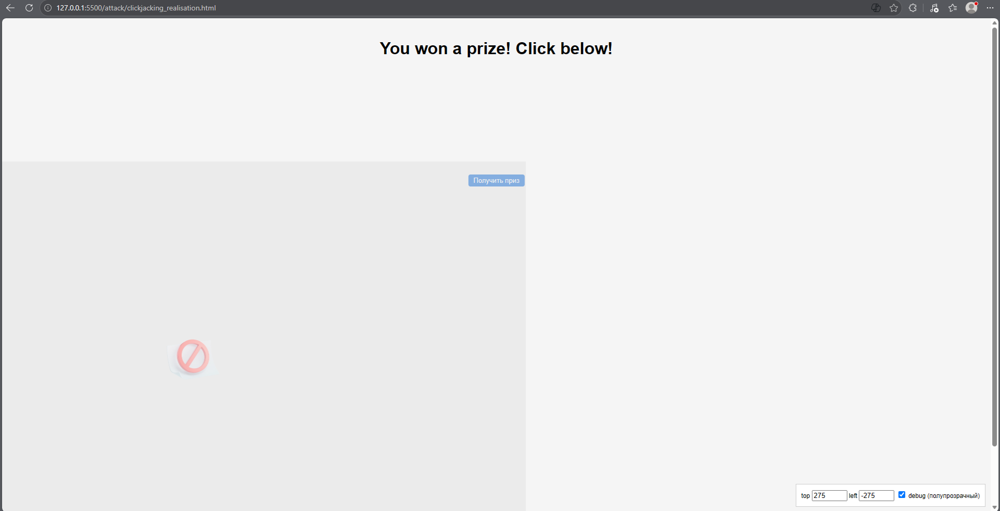

# Clickjacking (Stage 15)

## Vulnerability Description
The application’s chat interface contains a "Logout" button that performs a state-changing action. Although this endpoint was protected against traditional CSRF attacks by requiring a POST request with a valid token, it remained vulnerable to **Clickjacking**.

Because the application did not send `X-Frame-Options` or `Content-Security-Policy: frame-ancestors` headers, an attacker could embed the authenticated chat page inside a transparent `<iframe>` on a malicious site. By positioning the iframe so that the legitimate "Logout" button overlapped with a decoy button (e.g., "Get Prize"), the attacker could trick the victim into unknowingly submitting the logout form with their own valid session and CSRF token.

Note: The application intentionally renders URLs in messages as plain text (using `textContent`) to prevent DOM-based XSS. This means the malicious link in the test scenario is displayed as text rather than a clickable hyperlink, but the exploitation mechanics remain identical for demonstration purposes.

## Test Scenarios
1. Verify that the `/logout` endpoint rejects GET requests and invalid tokens (CSRF protection).
2. Attempt to load the `/chat` page inside an `<iframe>` hosted on a different origin.
3. Calibrate the iframe position to overlay the "Logout" button with a decoy element.
4. Confirm that clicking the decoy triggers the logout action using the victim's session.

## Exploitation Steps
1. Logged in to the messenger as `admin`.
2. Verified that direct CSRF via `` fails due to POST+Token requirement.
3. Created a malicious page (`clickjacking_realisation.html`) containing a decoy button and a transparent iframe loading `http://127.0.0.1:5000/chat`.
4. Injected a message from user "Ivan" containing the link to the malicious page to simulate social engineering.
5. Opened the link in the same browser session. The iframe loaded the chat page with the active session.
6. Calibrated the iframe position (`top: 275px`, `left: -275px`) so the "Logout" button aligned perfectly under the "Get Prize" button.
7. Clicked the "Get Prize" button. The click was intercepted by the hidden "Logout" button in the iframe.
8. The server processed the POST request with the valid CSRF token and session cookies, logging the user out.

## Evidence

### Decoy Page with Transparent Iframe (Debug Mode)


### Successful Exploitation (Session Terminated)


### Vulnerable Code (Missing Headers)


## Mitigation
To fix this vulnerability, security headers were added to all server responses to prevent the application from being embedded in iframes.

1. **X-Frame-Options: DENY** – Instructs browsers to completely block rendering of the page inside any frame.
2. **Content-Security-Policy: frame-ancestors 'none'** – Modern CSP directive that reinforces the restriction across all modern browsers.

These headers were implemented globally using Flask’s `@app.after_request` decorator.

### Fixed Code
```python
@app.after_request
def add_security_headers(response):
    response.headers['X-Frame-Options'] = 'DENY'
    response.headers['Content-Security-Policy'] = "frame-ancestors 'none'"
    return response
```

## Evidence (Defense)

### Secure Headers Implementation


### Exploit Blocked (Iframe Refused to Connect)
