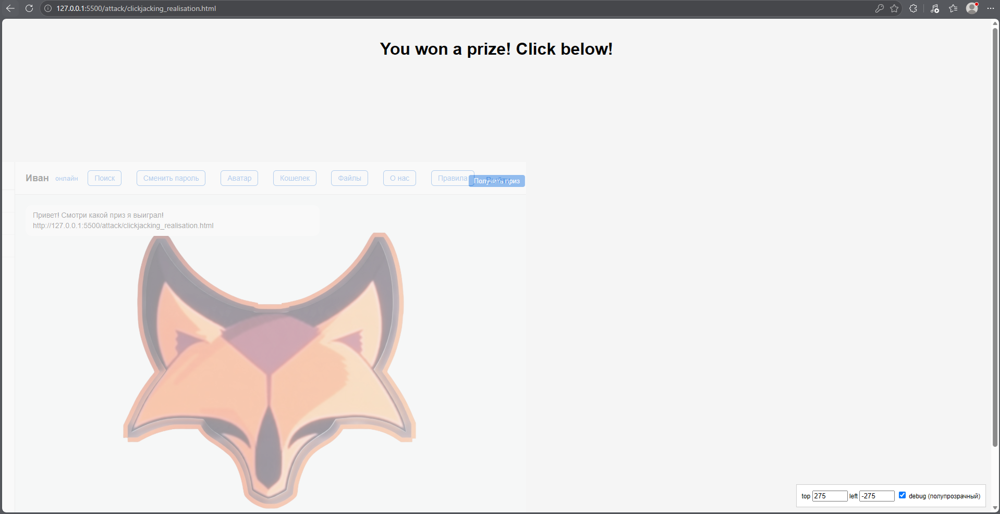
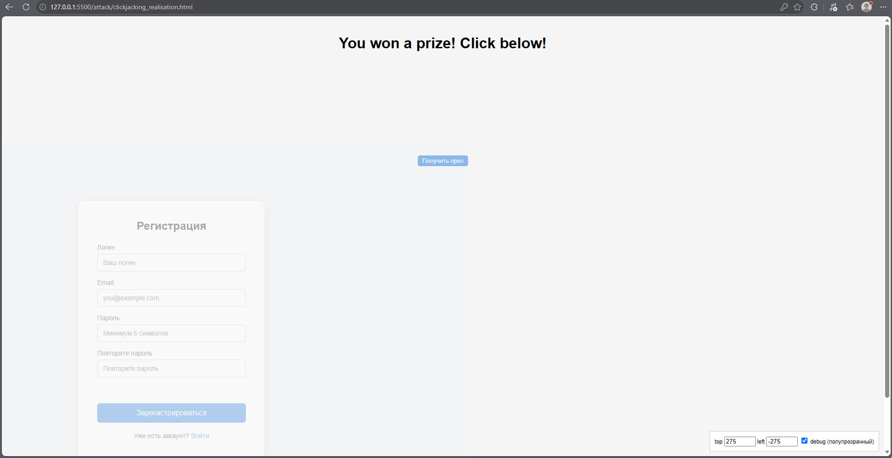
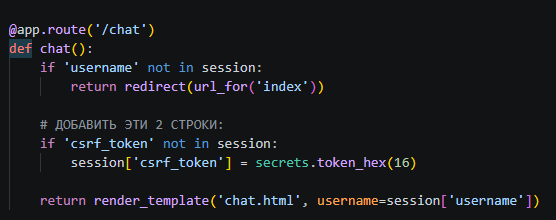
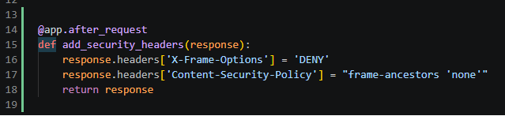
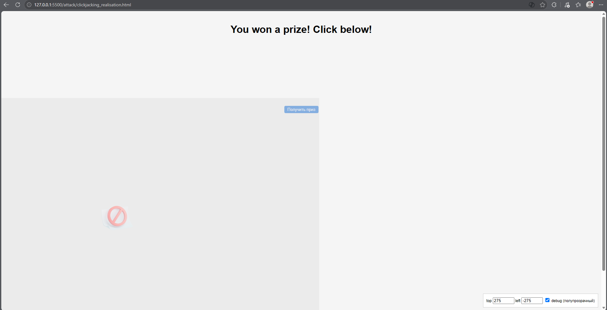

# Clickjacking (Stage 15)

## Описание уязвимости
Интерфейс чата приложения содержит кнопку «Выйти», выполняющую действие, изменяющее состояние. Хотя этот эндпоинт был защищен от традиционных CSRF-атак за счет требования POST-запроса с валидным токеном, он оставался уязвимым к **кликджекингу**.

Поскольку приложение не отправляло заголовки `X-Frame-Options` или `Content-Security-Policy: frame-ancestors`, злоумышленник мог встроить аутентифицированную страницу чата внутрь прозрачного `<iframe>` на вредоносном сайте. Разместив iframe так, чтобы легитимная кнопка «Выйти» перекрывалась кнопкой-приманкой (например, «Получить приз»), злоумышленник мог обманом заставить жертву неосознанно отправить форму выхода, используя её собственную валидную сессию и CSRF-токен.

Примечание: Приложение намеренно отображает URL-адреса в сообщениях как обычный текст (с помощью `textContent`) для предотвращения DOM-уязвимостей XSS. Это означает, что вредоносная ссылка в тестовом сценарии отображается как текст, а не как кликабельная гиперссылка, но механика эксплуатации остается идентичной для целей демонстрации.

## Сценарии тестирования
1. Проверить, что эндпоинт `/logout` отклоняет GET-запросы и невалидные токены (защита от CSRF).
2. Попытаться загрузить страницу `/chat` внутри `<iframe>`, размещенного на другом домене.
3. Откалибровать положение iframe, чтобы наложить кнопку «Выйти» на элемент-приманку.
4. Подтвердить, что клик по приманке инициирует действие выхода с использованием сессии жертвы.

## Шаги эксплуатации
1. Выполнен вход в мессенджер как `admin`.
2. Проверено, что прямой CSRF через `` не работает из-за требования POST+Token.
3. Создана вредоносная страница (`clickjacking_realisation.html`), содержащая кнопку-приманку и прозрачный iframe, загружающий `http://127.0.0.1:5000/chat`.
4. Внедрено сообщение от пользователя «Иван», содержащее ссылку на вредоносную страницу, для имитации социальной инженерии.
5. Ссылка открыта в той же сессии браузера. Iframe загрузил страницу чата с активной сессией.
6. Откалибровано положение iframe (`top: 275px`, `left: -275px`) так, чтобы кнопка «Выйти» идеально совместилась под кнопкой «Получить приз».
7. Нажата кнопка «Получить приз». Клик был перехвачен скрытой кнопкой «Выйти» внутри iframe.
8. Сервер обработал POST-запрос с валидным CSRF-токеном и куки сессии, выполнив выход пользователя.

## Evidence

### Страница-приманка с прозрачным iframe (режим отладки)


### Успешная эксплуатация (сессия завершена)


### Уязвимый код (отсутствие заголовков)


## Меры по устранению
Для устранения этой уязвимости заголовки безопасности были добавлены ко всем ответам сервера, чтобы предотвратить встраивание приложения в iframe.

1. **X-Frame-Options: DENY** – предписывает браузерам полностью блокировать рендеринг страницы внутри любого фрейма.
2. **Content-Security-Policy: frame-ancestors 'none'** – современная директива CSP, усиливающая это ограничение во всех современных браузерах.

Эти заголовки были реализованы глобально с помощью декоратора Flask `@app.after_request`.

### Исправленный код
```python
@app.after_request
def add_security_headers(response):
    response.headers['X-Frame-Options'] = 'DENY'
    response.headers['Content-Security-Policy'] = "frame-ancestors 'none'"
    return response
```

## Evidence (Defense)

### Реализация безопасных заголовков


### Эксплуатация заблокирована (iframe отказался подключаться)
