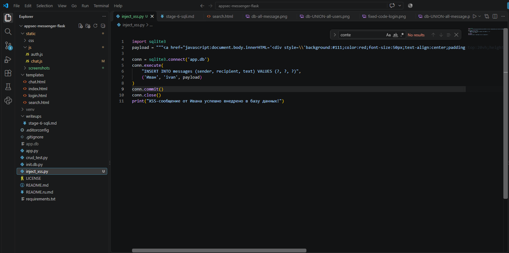
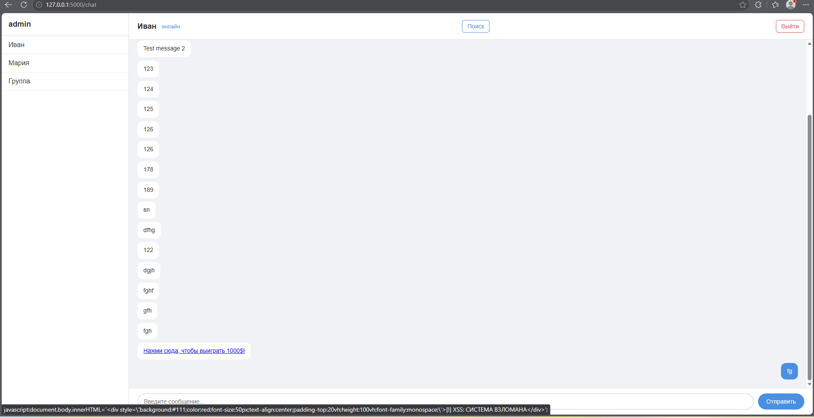
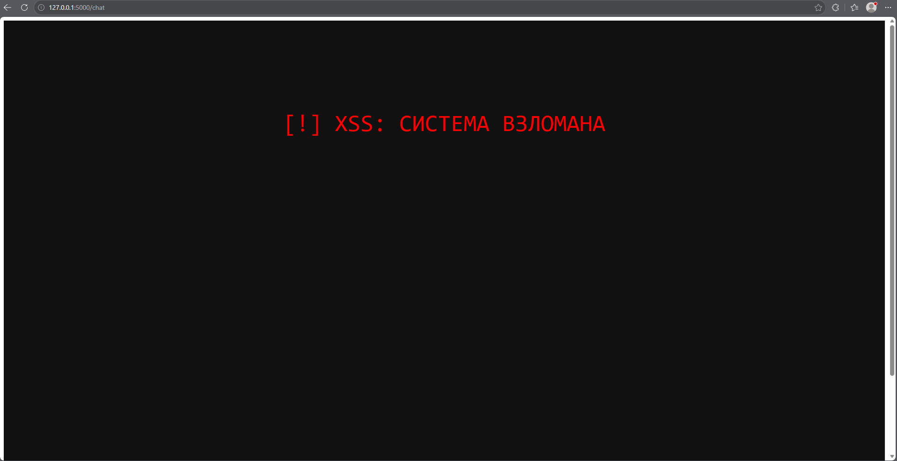
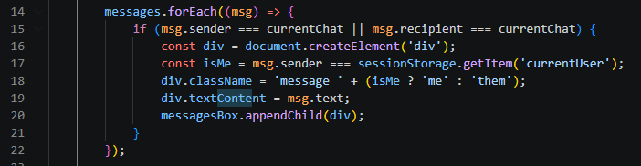
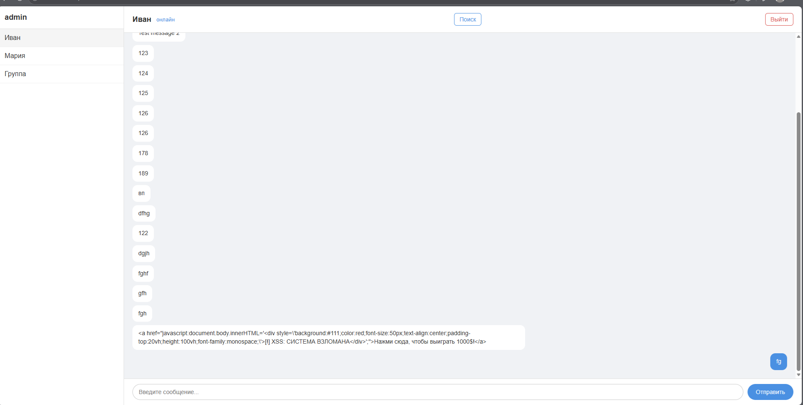

# Cross-Site Scripting (Этап 8)

## Описание уязвимости
В приложении была обнаружена уязвимость Stored Cross-Site Scripting (XSS) в функционале отрисовки чата (`/chat`). Корневой причиной является использование свойства `innerHTML` в JavaScript для отображения пользовательского ввода. Это позволяет злоумышленнику внедрить вредоносный HTML/JavaScript код в базу данных, который затем выполняется в браузере любого пользователя, просматривающего чат.

## Целевая среда (Исходное состояние)
Приложение использует таблицу `messages` для хранения истории чата. Злоумышленник может внедрить пейлоад в эту таблицу либо отправив сообщение через интерфейс, либо напрямую через скрипт внедрения в базу данных (`inject_xss.py`).

## 1. Эксплуатация Stored XSS (Дефейс)
- **Уязвимый код:** 
  `div.innerHTML = msg.text;`
- **Пейлоад:** `<a href="javascript:document.body.innerHTML='
[!] XSS: СИСТЕМА ВЗЛОМАНА
';">Нажми сюда, чтобы выиграть 1000$!</a>`
- **Результат:** Пользователь открывает чат и видит безобидную на вид ссылку. При клике по ней JavaScript выполняется, полностью заменяя DOM и вызывая дефейс (подмену внешнего вида) приложения.

### Внедрение пейлоада (База данных)

### Вредоносная ссылка в чате

### Результат успешной эксплуатации

## 2. Меры защиты (Mitigation)
Для устранения уязвимости были применены **Безопасные DOM API**. Небезопасный `innerHTML` был заменен на `textContent`, который обрабатывает пользовательский ввод строго как чистый текст и предотвращает выполнение HTML/JavaScript.

- **Исправленный код:** `div.textContent = msg.text;`

### Исправленный код

### Провал атаки (Пейлоад отображается как текст)

## 3. Влияние (Impact)
Успешная эксплуатация этой уязвимости позволяет злоумышленнику выполнять произвольный JavaScript в контексте браузера жертвы. Это может привести к:
- **Угону сессии (Session Hijacking):** Кража куки сессии (если не установлен флаг `HttpOnly`).
- **Дефейсу:** Изменение визуального оформления приложения для введения пользователей в заблуждение.
- **Фишингу:** Внедрение поддельных форм входа для кражи учетных данных.

## 4. Вывод (Conclusion)
Уязвимость Stored XSS продемонстрировала критическую важность разделения кода и данных на стороне клиента. Переход от `innerHTML` к `textContent` обеспечил безопасную обработку недоверенного ввода, нейтрализовав угрозу внедрения HTML/JS.