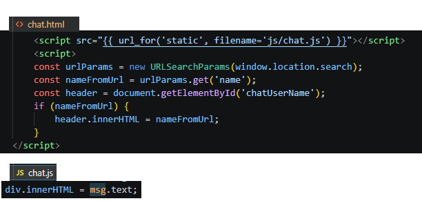
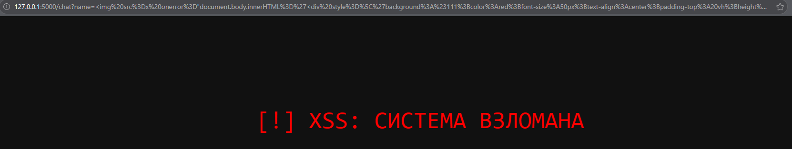
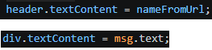
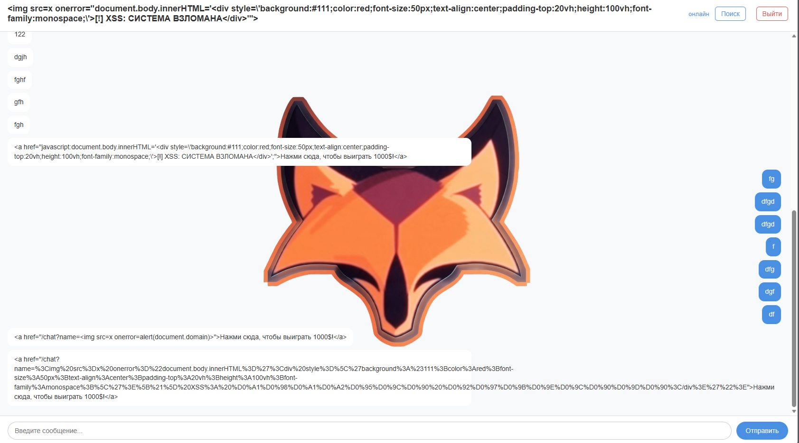

# DOM-based Cross-Site Scripting (Этап 9)

## Описание уязвимости
В приложении была обнаружена уязвимость DOM-based Cross-Site Scripting (DOM XSS). В отличие от Reflected или Stored XSS, серверный код полностью безопасен и не обрабатывает пейлоад. Уязвимость существует исключительно в клиентском JavaScript.

Корневой причиной является небезопасный поток данных (Source to Sink):
1. **Source (Источник):** Скрипт читает параметр `name` из URL (`window.location.search`).
2. **Sink (Сток):** Скрипт записывает эти данные напрямую в DOM, используя небезопасное свойство `innerHTML`.

Поскольку `innerHTML` парсит строки как HTML, злоумышленник может выполнить произвольный JavaScript, внедрив HTML-теги с обработчиками событий.

## Шаги эксплуатации
1. Злоумышленник формирует вредоносный URL, содержащий пейлоад в параметре `name`:
   `http://127.0.0.1:5000/chat?name=[!] XSS: СИСТЕМА ВЗЛОМАНА
'">`
2. Жертва кликает по ссылке. Браузер запрашивает страницу у сервера.
3. Сервер возвращает безопасную, статичную HTML-страницу.
4. Браузер выполняет клиентский JavaScript, который извлекает пейлоад из URL и передает его в `innerHTML`.
5. Браузер парсит внедренный тег ``, вызывает событие `onerror` и выполняет JavaScript, полностью ломая (дефейся) приложение.

## Доказательства (Эксплуатация)

### Уязвимый код

### Результат DOM XSS дефейса

## Меры защиты (Mitigation)
Для устранения DOM XSS приложение должно избегать небезопасных DOM API и использовать **Контекстное экранирование вывода** (Безопасные DOM API).
1. **Безопасный Sink:** Заменили `header.innerHTML = nameFromUrl` на `header.textContent = nameFromUrl`. Это заставляет браузер воспринимать пейлоад как чистый текст и предотвращает его выполнение.
2. **Дополнительное исправление:** Вернули `div.textContent = msg.text` в отрисовку чата, чтобы предотвратить доставку пейлоада через кликабельную ссылку (Stored XSS).

## Доказательства (Защита)

### Исправленный код

### Провал атаки (Пейлоад отображается как текст)

---

## Сравнение типов XSS (Reflected vs Stored vs DOM)

| Характеристика | Reflected XSS | Stored XSS | DOM XSS |
| :--- | :--- | :--- | :--- |
| **Локализация уязвимости** | Серверная часть (Backend) | Серверная часть + База данных | Клиентская часть (JavaScript) |
| **Роль сервера** | Активно отражает пейлоад в ответе | Сохраняет и извлекает пейлоад из БД | Пассивная (отдает безопасный, статичный HTML) |
| **Выполнение пейлоада** | В HTTP-ответе от сервера | Когда пользователь открывает зараженную страницу | Когда клиентский JS читает URL |
| **Масштаб атаки** | Точечная (требует отправки ссылки) | Массовая (затрагивает всех пользователей) | Точечная (требует отправки ссылки) |